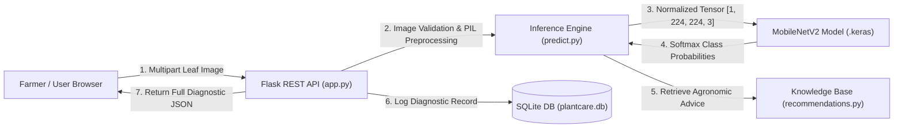

# 🌱 PlantCare AI — AI Plant Disease Detection & Smart Farming Assistant

[](https://www.python.org/)
[](https://palletsprojects.com/p/flask/)
[](https://www.tensorflow.org/)
[](https://www.sqlite.org/)
[](LICENSE)

An end-to-end, full-stack, hackathon-ready agricultural AI application that detects crop pathogens from leaf photos and delivers actionable, organic-first disease management and prevention recommendations.

---

## 📋 Table of Contents
1. [Project Overview & Problem Statement](#-project-overview--problem-statement)
2. [Key Features](#-key-features)
3. [System Architecture & AI Workflow](#-system-architecture--ai-workflow)
4. [Technology Stack](#-technology-stack)
5. [Project Folder Structure](#-project-folder-structure)
6. [Beginner Quickstart Guide (Windows & VS Code)](#-beginner-quickstart-guide-windows--vs-code)
7. [Dataset Setup & Model Training](#-dataset-setup--model-training)
8. [Backend REST API Reference](#-backend-rest-api-reference)
9. [Automated Testing](#-automated-testing)
10. [Hackathon Presentation Materials](#-hackathon-presentation-materials)
11. [Ethical AI & Agricultural Safety](#-ethical-ai--agricultural-safety)

---

## 🌿 Project Overview & Problem Statement

### Problem:
Smallholder farmers, home gardeners, and agricultural workers lose between **20% and 40%** of their annual crop yields to preventable fungal and bacterial foliar diseases. In many rural communities, access to certified agronomists and diagnostic laboratories is prohibitively slow or expensive. Misdiagnosing plant diseases leads to either total crop failure or the excessive, harmful misapplication of synthetic chemical pesticides.

### Solution:
**PlantCare AI** provides an accessible, web-based diagnostic assistant. By uploading a single leaf photograph, growers receive:
- Rapid classification across **20 major crop and disease categories**.
- Calibrated confidence scoring with low-confidence safety guards ($<60\%$).
- Clear distinctions between healthy foliage and dangerous pathogens.
- Pragmatic immediate care steps, organic bio-control options, and cultural prevention practices.
- Persistent local scan history to track infection outbreaks over time.

---

## ✨ Key Features

- **MobileNetV2 Transfer Learning:** Lightweight convolutional architecture (3.4M parameters) optimized for fast inference on consumer laptops and edge devices.
- **Out-of-Distribution & Uncertainty Safeguards:** Warns users when image confidence is low rather than presenting uncertain predictions as facts.
- **Organic-First Recommendations:** Avoids unverified chemical prescriptions; emphasizes pruning, sanitation, canopy aeration, and non-toxic bio-fungicides.
- **Interactive Single-Page Dashboard:** Built with pure HTML5/CSS3/ES6—no complex node setup required.
- **Pre-Loaded Sample Testing:** Test the application instantly without needing real leaf photos.
- **Scan History & Analytics:** Embedded SQLite database logging recent diagnoses, health ratios, and pathogen frequencies.
- **Interactive Disease Library:** Searchable encyclopedia of 20 supported crop diseases with symptoms and cultural management practices.

---

## 🏗️ System Architecture & AI Workflow

### Diagnostic Workflow Pipeline:
```
Leaf Image Upload
       │
       ▼
[Image Preprocessing] ──► (Verify integrity ➔ Convert to RGB ➔ Resize to 224x224 ➔ Scale [-1, 1])
       │
       ▼
[MobileNetV2 Backbone] ──► (Feature Extraction: micro-lesions, chlorosis, halos)
       │
       ▼
[Classification Head] ──► (GlobalAvgPool ➔ BatchNorm ➔ Dropout ➔ Dense ➔ Softmax)
       │
       ▼
[Confidence Calibration Check]
  ├── If Confidence < 60% ──► Flag Low Confidence & Advisory Warning
  └── If Confidence >= 60% ──► Accept Primary Class Candidate
       │
       ▼
[Agronomic Knowledge Base Mapping] ──► (Immediate Care, Prevention, Organic Controls)
       │
       ▼
[SQLite Audit Logging] ──► (Persistent Diagnostic History & Dashboard Telemetry)
```



---

## 🛠️ Technology Stack

| Layer | Technology | Rationale |
|---|---|---|
| **Frontend** | HTML5, CSS3, Vanilla ES6 JavaScript | Zero build step, blazing-fast browser performance, responsive design |
| **Backend REST API** | Python 3.11, Flask 2.3+, Flask-CORS | Lightweight, beginner-friendly, standard in production AI microservices |
| **Machine Learning** | TensorFlow 2.13+, Keras, MobileNetV2 | Transfer learning efficiency, low memory footprint, high accuracy |
| **Image Processing** | Pillow (PIL), NumPy | Fast image decoding, Lanczos resampling, tensor normalization |
| **Database** | SQLite 3 | Zero-configuration serverless database embedded directly in Python |
| **Testing** | Pytest | Industry-standard unit and integration testing framework |

---

## 📁 Project Folder Structure

```text
ai crop project/
├── backend/
│   ├── app.py                 # Flask REST API and static frontend router
│   ├── predict.py             # Inference engine, image verification, preprocessing
│   ├── train_model.py         # MobileNetV2 transfer learning training pipeline
│   ├── recommendations.py     # Structured agronomic disease knowledge base
│   ├── database.py            # SQLite database schema, logging, and statistics
│   ├── requirements.txt       # Pinned Python package dependencies
│   └── models/
│       ├── .gitkeep           # Preserves model directory in version control
│       └── class_indices.json # 20-class mapping generated from dataset
├── frontend/
│   ├── index.html             # Single-page application structure & UI layout
│   ├── styles.css             # Modern agricultural design system & animations
│   └── script.js              # UI state management, API requests, dropzone logic
├── dataset/
│   └── README.md              # Instructions for downloading PlantVillage dataset
├── tests/
│   └── test_api.py            # Comprehensive Pytest automated test suite
├── .env.example               # Template environment configuration variables
├── .env                       # Active local configuration file
├── .gitignore                 # Excludes heavy weights, virtualenvs, and datasets
└── README.md                  # Complete project documentation & guide
```

---

## 🚀 Beginner Quickstart Guide (Windows & VS Code)

Follow these exact steps in **Windows PowerShell** to run the complete working website:

### Step 1: Open VS Code in Project Directory
Open **Visual Studio Code**, press `Ctrl + ~` to open the integrated PowerShell terminal, and verify your current location:
```powershell
pwd
```
*(It should show `c:\Users\uppar\Downloads\ai crop project`)*

### Step 2: Create a Python Virtual Environment
Creating a virtual environment ensures that the project dependencies do not interfere with system-wide software:
```powershell
python -m venv .venv
```

### Step 3: Activate the Virtual Environment
```powershell
.\.venv\Scripts\Activate.ps1
```
> **Tip:** If PowerShell gives an execution policy error, run this one-time command and re-activate:
> `Set-ExecutionPolicy -ExecutionPolicy RemoteSigned -Scope CurrentUser`

Your terminal prompt will now show `(.venv)` on the left.

### Step 4: Install Dependencies
```powershell
python -m pip install --upgrade pip
pip install -r backend/requirements.txt
```

### Step 5: Start the PlantCare AI Server
```powershell
python backend/app.py
```

You will see:
```text
============================================================
   🌱 PlantCare AI - Backend Server Starting
   API & Web UI: http://127.0.0.1:5000/
   Health check: http://127.0.0.1:5000/api/health
============================================================
```

### Step 6: Open the Website in Your Browser
Open your browser and navigate to:
👉 **[http://127.0.0.1:5000/](http://127.0.0.1:5000/)**

Click **"Scan Leaf"**, choose a pre-loaded sample (e.g., *🍅 Tomato Early Blight*), or drop any plant leaf image and click **"Analyze Leaf with AI"**!

---

## 📊 Dataset Setup & Model Training

### 1. Download PlantVillage
Download the free, legal PlantVillage dataset from [Kaggle: New Plant Diseases Dataset](https://www.kaggle.com/datasets/vipoooool/new-plant-diseases-dataset) and extract image folders into:
`dataset/PlantVillage/`

For detailed instructions, see [dataset/README.md](file:///dataset/README.md).

### 2. Run the Training Pipeline
Run the complete transfer learning script:
```powershell
python backend/train_model.py --epochs 15 --batch_size 32
```

**What the script does automatically:**
1. Partitions data: **70% Train, 15% Validation, 15% Held-Out Test** (zero data leakage).
2. Applies data augmentation (rotations, flips, zooms, contrast shifts).
3. Trains classification head on frozen MobileNetV2 backbone.
4. Performs gentle fine-tuning on the top 20 convolutional layers.
5. Saves the best model to `backend/models/plant_disease_mobilenetv2.keras`.
6. Saves class index mapping to `backend/models/class_indices.json`.
7. Evaluates on the held-out test set and outputs:
   - Precision, Recall, and F1-Scores.
   - Saves `confusion_matrix.png` and `training_history.png`.

> **Note on Demo Mode:**
> Until you train your own model with `train_model.py`, the backend runs in a transparent **Simulation Demo Mode** so you can test all features and UI workflows immediately.

---

## 🔌 Backend REST API Reference

### 1. Health Check
`GET /api/health`
```json
{
  "status": "healthy",
  "service": "PlantCare AI API",
  "version": "1.0.0",
  "model": {
    "model_loaded": false,
    "classes_count": 20,
    "status_detail": "Model operational"
  },
  "database": {
    "status": "connected",
    "total_scans_logged": 1
  }
}
```

### 2. Supported Classes
`GET /api/classes`
Returns all 20 supported crop and disease labels grouped by plant species.

### 3. Leaf Prediction
`POST /api/predict` (Multipart form-data with file field `image`)
```json
{
  "success": true,
  "plant_type": "Tomato",
  "disease_name": "Early Blight (Alternaria linariae / solani)",
  "status": "diseased",
  "status_label": "Potentially Diseased",
  "confidence": 0.9421,
  "confidence_pct": 94.21,
  "is_low_confidence": false,
  "top_predictions": [
    {
      "plant": "Tomato",
      "disease": "Early Blight",
      "confidence_pct": 94.21
    }
  ],
  "recommendations": {
    "severity": "Moderate to High",
    "symptoms": ["Dark brown to black spots with concentric rings."],
    "immediate_actions": ["Prune infected lower foliage.", "Apply clean straw mulch."],
    "preventative_measures": ["Rotate solanaceous crops for 3 years."],
    "organic_controls": ["Copper octanoate or Bacillus amyloliquefaciens sprays."],
    "expert_consultation": "Consult extension if defoliation exceeds 40%."
  },
  "disclaimer": "AI predictions are assistive decision-support tools..."
}
```

### 4. Scan History & Statistics
`GET /api/history?limit=20`
Returns recent scan records and aggregate counts (healthy, diseased, average confidence).

### 5. Clear History
`POST /api/history/clear`
Clears diagnostic records from SQLite.

---

## 🧪 Automated Testing

Execute the automated test suite using `pytest`:
```powershell
pytest tests/test_api.py -v
```

**Test Coverage:**
- ✅ `/api/health` connectivity
- ✅ `/api/classes` class loading
- ✅ `/api/library` knowledge base retrieval
- ✅ Valid image prediction & recommendation enrichment
- ✅ Missing file rejection (HTTP 400)
- ✅ Invalid file extension rejection (HTTP 400)
- ✅ Corrupt image byte stream rejection (HTTP 400)
- ✅ SQLite scan logging, statistics calculation, and history clearing
- ✅ Agricultural knowledge base consistency and fallback handling

---

## 🎤 Hackathon Presentation Materials

### Project Abstract:
> "PlantCare AI is an intelligent smart farming assistant that democratizes plant pathology diagnosis for smallholder farmers and gardeners. Utilizing MobileNetV2 transfer learning, the system identifies 20 crop disease classes from leaf photos with calibrated confidence safety checks, an organic-first treatment knowledge base, and zero-configuration SQLite telemetry."

### 2-Minute Demonstration Script:
1. **The Problem (0:00 - 0:25):** *"Over 30% of global crop yields are lost to leaf blights, rusts, and bacterial spots. Small farmers often cannot access plant pathologists and inadvertently overuse harmful chemicals."*
2. **The Solution (0:25 - 0:50):** *"PlantCare AI bridges this gap. By uploading a photo of a struggling leaf, our MobileNetV2 neural vision model extracts lesion patterns in milliseconds, determining whether the plant is healthy or diseased."*
3. **The Live Demo (0:50 - 1:25):** *"Watch this in action: We upload a leaf photo. PlantCare AI verifies the image, resizes it to 224x224, and outputs the diagnosis—Tomato Early Blight with 94% confidence. It immediately provides organic remedies: mulching against soil splash, pruning diseased leaves, and using bio-fungicides."*
4. **Safety & Analytics (1:25 - 1:45):** *"Notice our calibrated safety check: If an image is out-of-distribution or under 60% confidence, we warn the user rather than guessing. Furthermore, every scan logs to our dashboard to track local farm outbreaks."*
5. **Conclusion (1:45 - 2:00):** *"PlantCare AI empowers growers with rapid, sustainable, and scientifically responsible plant protection. Thank you!"*

### 5-Slide Presentation Outline:
- **Slide 1: Title & Vision:** PlantCare AI — Sustainable crop protection through computer vision.
- **Slide 2: Problem & Social Impact:** Crop loss statistics, agricultural lab shortages, chemical overuse risks.
- **Slide 3: Architecture & Innovation:** MobileNetV2 transfer learning, out-of-distribution safeguards, zero-data-leakage pipeline.
- **Slide 4: Product Demo & Dashboard:** Live scan walkthrough, organic treatment recommendations, historical farm telemetry.
- **Slide 5: Future Roadmap & Limitations:** Edge deployment (Raspberry Pi/TFLite), drone imagery integration, local soil sensor fusion.

---

## 🛡️ Ethical AI & Agricultural Safety

- **Decision-Support Only:** PlantCare AI is an assistive advisory tool, not a replacement for on-site agronomists or laboratory testing.
- **Organic & Cultural Focus:** Recommendations strictly emphasize hygiene, drip irrigation, crop rotation, and bio-controls before synthetic inputs.
- **Confidence Calibration:** High softmax scores can occur on out-of-distribution images; our system explicitly alerts users when visual confidence is marginal.
- **Data Privacy:** Scans and logs remain on your local machine in SQLite. No farm images or geolocation data are transmitted to third parties without consent.

---

## 📄 License
This project is open-source under the MIT License.
